# Modelo Relacional — Academit

> Diagrama Entidad-Relación institucional en Mermaid generado automáticamente a partir de `database/01-schema.sql` mediante `tools/diccionario-datos.py`.
> Validado formalmente con `@mermaid-js/mermaid-cli` (mmdc).

Para ver la especificación exhaustiva de cada campo, tipo de dato y restricciones, consultá el [Diccionario de Datos](diccionario-de-datos.md).
Los datos de demostración y catálogos iniciales se encuentran documentados en [database/README.md](../../database/README.md) y [database/02-datos-iniciales.sql](../../database/02-datos-iniciales.sql).

---

## Diagrama Entidad-Relación (32 tablas)

```mermaid
erDiagram
    carrera ||--|| plan_estudio : "carrera"
    plan_estudio ||--o{ alumno : "plan"
    estado_persona ||--o{ alumno : "estado_persona"
    estado_persona ||--o{ docente : "estado_persona"
    rol ||--o{ usuario : "rol"
    alumno ||--|| usuario : "alumno"
    docente ||--|| usuario : "docente"
    ciclo_lectivo ||--|| curso : "ciclo"
    carrera ||--|| curso : "carrera"
    plan_estudio ||--o{ curso : "plan"
    plan_estudio ||--o{ plan_materia : "plan"
    materia ||--o{ plan_materia : "materia"
    plan_materia ||--o{ correlativa : "plan"
    plan_materia ||--o{ correlativa : "materia"
    plan_materia ||--o{ correlativa : "materia_requerida"
    curso ||--|| curso_materia : "curso"
    materia ||--|| curso_materia : "materia"
    docente ||--|| curso_materia : "docente"
    alumno ||--o{ inscripcion : "alumno"
    curso ||--o{ inscripcion : "curso"
    ciclo_lectivo ||--o{ inscripcion : "ciclo"
    alumno ||--|| matricula : "alumno"
    ciclo_lectivo ||--|| matricula : "ciclo"
    estado_matricula ||--o{ matricula : "estado_matricula"
    matricula ||--|| cuota : "matricula"
    tipo_cuota ||--|| cuota : "tipo_cuota"
    estado_cuota ||--o{ cuota : "estado_cuota"
    cuota ||--|| pago : "cuota"
    usuario ||--o{ pago : "usuario"
    medio_pago ||--o{ pago : "medio_pago"
    curso_materia ||--o{ evaluacion : "curso_materia"
    tipo_evaluacion ||--o{ evaluacion : "tipo_evaluacion"
    evaluacion ||--|| calificacion : "evaluacion"
    alumno ||--|| calificacion : "alumno"
    alumno ||--|| asistencia : "alumno"
    curso ||--|| asistencia : "curso"
    materia ||--|| asistencia : "materia"
    estado_asistencia ||--o{ asistencia : "estado_asistencia"
    materia ||--o{ mesa_examen : "materia"
    docente ||--o{ mesa_examen : "docente"
    mesa_examen ||--o{ inscripcion_mesa : "mesa"
    alumno ||--o{ inscripcion_mesa : "alumno"
    alumno ||--|| declaracion_jurada : "alumno"
    ciclo_lectivo ||--|| declaracion_jurada : "ciclo"
    declaracion_jurada ||--o{ declaracion_materia : "declaracion"
    materia ||--o{ declaracion_materia : "materia"
    alumno ||--o{ solicitud : "alumno"
    alumno ||--o{ documentacion : "alumno"

    rol {
        int id_rol PK
        string nombre
    }
    estado_persona {
        int id_estado_persona PK
        string nombre
    }
    estado_matricula {
        int id_estado_matricula PK
        string nombre
    }
    estado_cuota {
        int id_estado_cuota PK
        string nombre
    }
    tipo_cuota {
        int id_tipo_cuota PK
        string nombre
    }
    medio_pago {
        int id_medio_pago PK
        string nombre
    }
    tipo_evaluacion {
        int id_tipo_evaluacion PK
        string nombre
    }
    estado_asistencia {
        int id_estado_asistencia PK
        string nombre
    }
    carrera {
        int id_carrera PK
        string codigo
        string nombre
        string titulo_otorgado
        int duracion_anios
        string resolucion
        string estado
    }
    plan_estudio {
        int id_plan PK
        int id_carrera FK
        string codigo
        string nombre
        int anio_aprobacion
        string estado
    }
    alumno {
        int id_alumno PK
        string dni
        string apellido
        string nombre
        date fecha_nacimiento
        string domicilio
        string telefono
        string email
        date fecha_ingreso
        int id_estado_persona FK
        int id_plan FK
    }
    docente {
        int id_docente PK
        string dni
        string apellido
        string nombre
        string telefono
        string email
        string titulo
        int id_estado_persona FK
    }
    usuario {
        int id_usuario PK
        string username
        string password_hash
        boolean activo
        int id_rol FK
        int id_alumno FK
        int id_docente FK
    }
    ciclo_lectivo {
        int id_ciclo PK
        int anio
        string nombre
        string estado
        date fecha_inicio
        date fecha_fin
    }
    curso {
        int id_curso PK
        string codigo
        string nombre
        string turno
        int capacidad_maxima
        string aula
        int id_ciclo FK
        int id_carrera FK
        int id_plan FK
    }
    materia {
        int id_materia PK
        string codigo
        string nombre
        string regimen
        int horas_semanales
        boolean activa
    }
    plan_materia {
        int id_plan PK,FK
        int id_materia PK,FK
        int anio_plan
    }
    correlativa {
        int id_plan PK,FK
        int id_materia PK,FK
        int id_materia_requerida PK,FK
    }
    curso_materia {
        int id_curso_materia PK
        int id_curso FK
        int id_materia FK
        int id_docente FK
        string rol_docente
    }
    inscripcion {
        int id_inscripcion PK
        int id_alumno FK
        int id_curso FK
        int id_ciclo FK
        date fecha
        boolean activa
    }
    matricula {
        int id_matricula PK
        int id_alumno FK
        int id_ciclo FK
        date fecha
        numeric importe
        int id_estado_matricula FK
    }
    cuota {
        int id_cuota PK
        int id_matricula FK
        int numero
        int id_tipo_cuota FK
        date fecha_vencimiento
        numeric importe
        int id_estado_cuota FK
    }
    pago {
        int id_pago PK
        int id_cuota FK
        int id_usuario FK
        date fecha
        numeric importe
        int id_medio_pago FK
        string comprobante
    }
    evaluacion {
        int id_evaluacion PK
        int id_curso_materia FK
        date fecha
        int id_tipo_evaluacion FK
        string descripcion
    }
    calificacion {
        int id_calificacion PK
        int id_evaluacion FK
        int id_alumno FK
        int nota
        string observacion
    }
    asistencia {
        int id_asistencia PK
        int id_alumno FK
        int id_curso FK
        int id_materia FK
        date fecha
        int id_estado_asistencia FK
    }
    mesa_examen {
        int id_mesa PK
        int id_materia FK
        int id_docente FK
        date fecha
        int cupo
        string tribunal
        string turno
        string hora
        string aula
        string estado
    }
    inscripcion_mesa {
        int id_inscripcion_mesa PK
        int id_mesa FK
        int id_alumno FK
        date fecha
        boolean activa
    }
    declaracion_jurada {
        int id_declaracion PK
        int id_alumno FK
        int id_ciclo FK
        date fecha
    }
    declaracion_materia {
        int id_declaracion PK,FK
        int id_materia PK,FK
    }
    solicitud {
        int id_solicitud PK
        int id_alumno FK
        string tipo
        date fecha_solicitud
        string motivo
        string observaciones
        string estado
        date fecha_resolucion
        string respuesta
    }
    documentacion {
        int id_documento PK
        int id_alumno FK
        string tipo
        boolean obligatorio
        string estado
        date fecha_entrega
        string observaciones
    }
```

